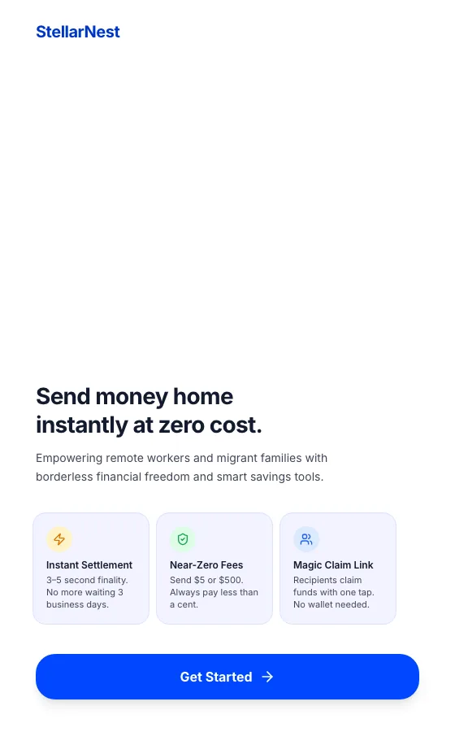
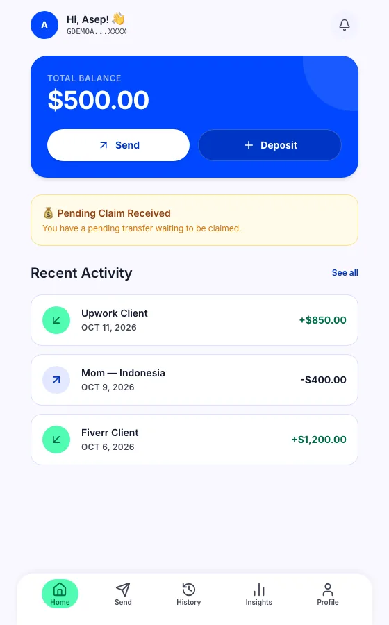
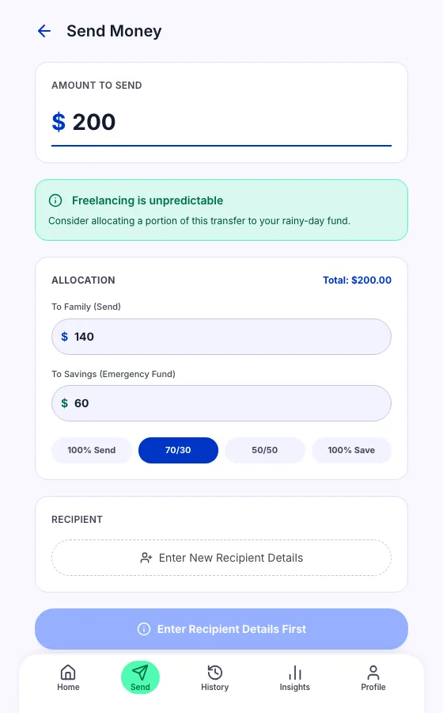
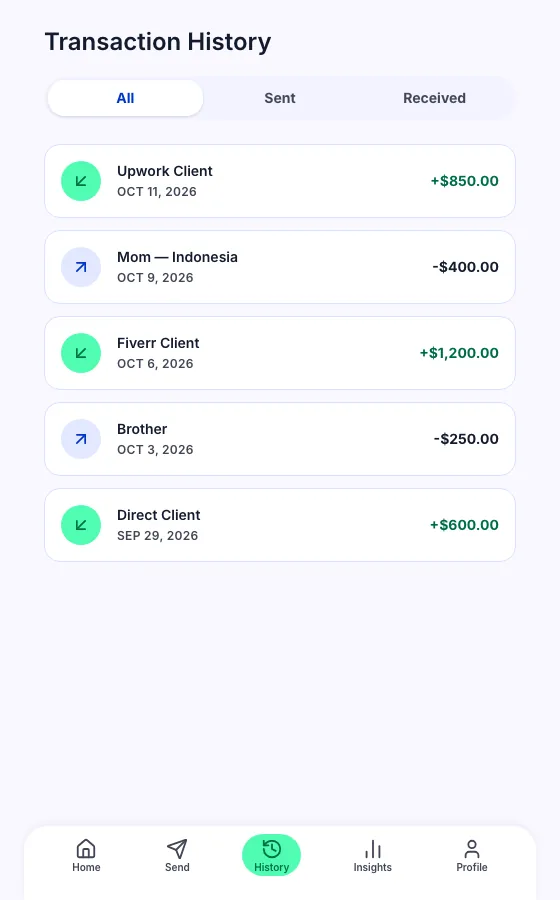
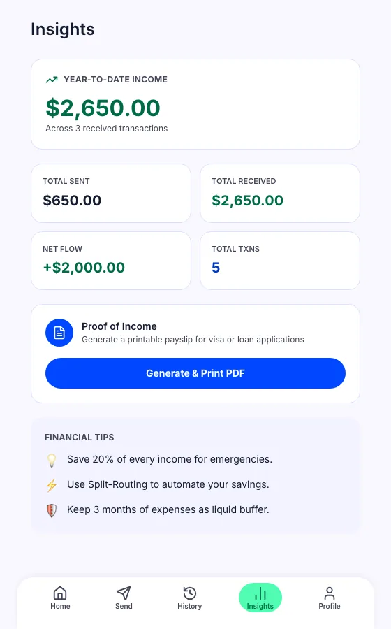
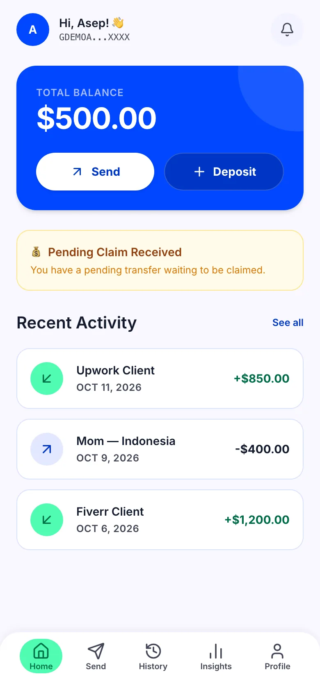

# StellarNest

> Cross-border payment app for Indonesian migrant workers and freelancers,
> built on the Stellar blockchain. Send money home — without a bank account, without high fees.

**Live demo: currently offline** (prototype; not submitted to the hackathon)
**· [🐙 GitHub Repo](https://github.com/seppam/stellarnest)**
**· [Built for the APAC Stellar Hackathon — July 2026 (prototype, not submitted)](https://www.risein.com/programs/apac-stellar-hackathon)**

[](https://stellar.org)
[](https://circle.com)
[](https://firebase.google.com)
[](https://react.dev)
[](https://vitejs.dev)
[](#license)

---

## 🎯 What Is StellarNest?

StellarNest lets Indonesian migrant workers and freelancers send money home through a
shareable **Magic Link** — the recipient claims funds via bank or e-wallet without
installing any app or creating a crypto wallet.

**Key differentiator**: every payment is automatically split between a **family
allocation** (default 70%) and an **emergency savings fund** (default 30%), enforced
on-chain in a single Stellar transaction.

---

## ✨ Features

| Feature | Status | Description |
|---|---|---|
| **Magic Claim Links** | Implemented (testnet) | Generate a payment URL; recipient claims via bank/e-wallet |
| **Split-Routing** | Implemented (testnet) | 70/30 (or custom) split enforced on the Stellar ledger |
| **Multi-Currency** | Implemented (testnet) | IDR, PHP, VND, THB, MYR, SGD with simulated settlement rates (no live payout rails) |
| **Stellar Wallet** | Implemented (testnet) | AES-GCM encrypted secret storage, USDC on testnet |
| **Proof of Income** | Implemented (testnet) | Auto-generated, ledger-verifiable income statements |
| **Insights Dashboard** | Implemented (testnet) | YTD income, monthly charts, transaction history |
| **Firebase Auth** | Implemented (testnet) | Anonymous magic link authentication |
| **Offline-First** | Implemented (testnet) | localStorage cache; syncs to Firestore on reconnect |
| **Bank Payout (VA/QRIS)** | 🔜 Soon | Indonesian VA and QRIS withdrawal flow |
| **Email Magic Link Delivery** | 🔜 Soon | Firebase Email Action handler for link delivery |
| **React Native Mobile App** | 🔜 Soon | App Store + Play Store deployment |
| **Micro-Loan Origination** | 🔜 Soon | On-chain income history drives loan approvals |

---

## 🌍 ASEAN Corridors

| Country | Currency | Settlement Networks | E-Wallets | Banks |
|---|---|---|---|---|
| 🇮🇩 Indonesia | IDR | BI-FAST, Giro, RTGS | GoPay, OVO, DANA, LinkAja | BCA, BNI, Mandiri, BRI, BSI |
| 🇵🇭 Philippines | PHP | InstaPay, PESONet, Express | GCash, Maya | BDO, BPI, UnionBank |
| 🇻🇳 Vietnam | VND | VietQR, Napas 247, FAST | MoMo, ZaloPay | VietinBank, VCB, BIDV |
| 🇹🇭 Thailand | THB | PromptPay, mBanking | TrueMoney, LINE Pay | SCB, Krungsri, K+ |
| 🇲🇾 Malaysia | MYR | DuitNow, FPX, IBG | Touch 'n Go, GrabPay | Maybank, CIMB, Public Bank |
| 🇸🇬 Singapore | SGD | PayNow, FAST, MEPS | PayNow, DBS PayLah! | DBS, OCBC, UOB |

---

## 🏗️ Technical Architecture

```
┌──────────────────────────────────────────────────────────┐
│                    React 19 SPA (Vite)                   │
│  ┌──────────────┐  ┌────────────────────────────────┐  │
│  │ AppContext   │  │  Services Layer                │  │
│  │ (state mgmt) │  │  stellar.ts · claim.service.ts │  │
│  │              │  │  crypto.ts · regional.ts        │  │
│  └──────────────┘  └────────────────────────────────┘  │
│         │                    │                          │
│  localStorage           Firestore (async, fire-and-forget)│
└─────────────────────────┬───────────────────────────────┘
                          │
        ┌─────────────────▼──────────────────┐
        │         Stellar Testnet             │
        │  Horizon: horizon-testnet.stellar.org│
        │  USDC Issuer: GBBD47IF6LWK7P7MDEV..│
        │  Treasury:  (set via env variable)  │
        │  Memo: CLAIM:<claimId> (max 28B)   │
        └────────────────────────────────────┘
```

**Tech stack:** React 19 · React Router 7 · Vite 8 · Firebase 12 · Firestore ·
`@stellar/stellar-sdk` v16 · Tailwind CSS 3.4 · Web Crypto API · Playwright

---

## 🔐 Security Architecture

Client-side encryption using the browser's native **Web Crypto API** (AES-256-GCM):

```
Stellar secret key
       │
       ▼ PBKDF2-SHA256
  Firebase UID (100,000 rounds)
       │
       ▼ AES-256-GCM (random IV per operation)
  base64(salt[16B] || ciphertext || iv[12B])
       │
       ▼ Stored in Firestore as `encryptedSecret`
```

- **Password**: Firebase Auth UID (stable, per-user, never transmitted in plaintext)
- **PBKDF2**: 100,000 iterations — NIST SP 800-132 compliant
- **AES-256-GCM**: authenticated encryption — confidentiality + integrity
- **Secret lifecycle**: decrypted in memory only (`React.useRef`); never written to
  `localStorage`; cleared on sign-out
- **Firestore breach**: encrypted blobs are computationally infeasible to crack without
  the Firebase UID and PBKDF2 salt

---

## 🔗 Smart Contract & On-Chain Identifiers

| Identifier | Value | Notes |
|---|---|---|
| **USDC Issuer (Testnet)** | `GBBD47IF6LWK7P7MDEVSCWR7DPUWV3NY3DTQEVFL4NAT4AQH3ZLLFLA5` | Circle testnet issuer |
| **Treasury Account** | Set via `VITE_STELLAR_TREASURY_SECRET` | Generated by `scripts/setup-treasury.ts` |
| **Stellar Network** | `Test SDF Network ; September 2015` | Stellar testnet |
| **Horizon API** | `https://horizon-testnet.stellar.org` | Transaction submission + account queries |
| **Friendbot** | `https://friendbot.stellar.org` | Testnet XLM faucet |
| **Trustline Limit** | 10,000,000 USDC | Per-trustline maximum |
| **Memo Format** | `CLAIM:<claimId>` | **Max 28 bytes** (Stellar SDK v16 constraint) |
| **Claim Expiry** | 7 days | Configurable in `claim.service.ts` |
| **Firebase Project** | `stellarnest-hackathon` | Firestore + Anonymous Auth |

---

## 📁 Project Structure

```
StellarNest/
├── scripts/
│   └── setup-treasury.ts      # One-time testnet treasury setup (run once)
├── src/
│   ├── App.tsx                # HashRouter + route definitions
│   ├── contexts/
│   │   └── AppContext.tsx     # Central state: auth, claims, transactions
│   ├── pages/
│   │   ├── Landing.tsx        # Marketing landing + onboarding
│   │   ├── Dashboard.tsx      # Balance card, pending claims, quick nav
│   │   ├── Send.tsx           # Amount, 70/30 split-routing, recipient
│   │   ├── Claim.tsx          # Magic Link redemption (public route)
│   │   ├── Withdraw.tsx       # Bank/e-wallet selection, claimFunds
│   │   ├── History.tsx        # Full transaction history
│   │   ├── Insights.tsx       # YTD income, charts, proof-of-income export
│   │   ├── Profile.tsx        # Wallet + encrypted secret management
│   │   └── TransactionDetail.tsx
│   ├── lib/
│   │   ├── stellar.ts         # Stellar SDK wrapper, MOCK_MODE toggle
│   │   ├── crypto.ts          # AES-256-GCM encrypt/decrypt
│   │   ├── firebase.ts        # Firebase app initialization
│   │   ├── storage.ts         # localStorage helpers + seed data
│   │   ├── regional.ts        # ASEAN country + currency config
│   │   └── services/
│   │       ├── claim.service.ts    # createClaim, getClaim, claimFunds
│   │       ├── user.service.ts     # Firebase profile CRUD
│   │       ├── auth.service.ts     # Firebase Auth helpers
│   │       └── transaction.service.ts
│   └── components/
│       ├── ui/BottomNav.tsx
│       ├── ui/ErrorBoundary.tsx
│       └── features/
│           ├── BalanceCard.tsx
│           └── TransactionItem.tsx
├── .env.example               # Environment variable template
└── .env.local                 # Private env vars (gitignored)
```

---

## 📸 Screenshots

Captured from a local run in demo mode (seeded sample data, placeholder Firebase config, no real backend). The
hosted demo is offline, so these are the reference visuals.

| | |
|---|---|
|  **Landing** |  **Dashboard** (seeded demo user) |
|  **Send** with 70/30 split-routing |  **History** |
|  **Insights** and Proof of Income |  **Dashboard, 390px mobile** |

---

## 🚀 Run locally (no Firebase or Stellar account needed)

The app has a built-in demo mode: opening `/dashboard?demo=1` seeds a local demo user and sample
transactions into `localStorage`, and `VITE_MOCK_MODE=true` mocks all Stellar calls. Placeholder
Firebase values are enough to render every screen shown above. Verified with Node 22+, npm 10+.

```bash
npm ci
VITE_FIREBASE_API_KEY=demo VITE_FIREBASE_AUTH_DOMAIN=demo.invalid \
VITE_FIREBASE_PROJECT_ID=demo-stellarnest VITE_FIREBASE_STORAGE_BUCKET=demo.invalid \
VITE_FIREBASE_MESSAGING_SENDER_ID=0 VITE_FIREBASE_APP_ID=demo VITE_MOCK_MODE=true \
npm run dev -- --port 3201
# open http://localhost:3201/dashboard?demo=1
npm run lint && npm run build     # lint (warnings only) and production build
```

Limits: sign-up/sign-in, real Firestore sync and live testnet transactions need your own Firebase project and
Stellar testnet setup (see Setup below). There are no unit tests; the Playwright scripts in `scripts/` target a
live backend.

---

## ⚙️ Setup & Configuration

### 1. Clone & install

```bash
git clone https://github.com/seppam/stellarnest.git
cd stellarnest
npm install
```

### 2. Environment variables

```bash
cp .env.example .env.local
# Edit .env.local with your values (see below)
```

**Required `.env.local` fields:**

```bash
# Firebase (from Firebase Console → Project Settings → General → Your apps)
VITE_FIREBASE_API_KEY=your_api_key_here
VITE_FIREBASE_AUTH_DOMAIN=your_project.firebaseapp.com
VITE_FIREBASE_PROJECT_ID=your_project_id
VITE_FIREBASE_STORAGE_BUCKET=your_project.firebasestorage.app
VITE_FIREBASE_MESSAGING_SENDER_ID=your_sender_id
VITE_FIREBASE_APP_ID=your_app_id

# Stellar
VITE_STELLAR_NETWORK=testnet        # or: public
VITE_STELLAR_TREASURY_SECRET=<from-scripts/setup-treasury.ts>

# Mode (default: true — mock transactions, no real blockchain calls)
VITE_MOCK_MODE=false                 # set to false for real testnet transactions
```

### 3. Run the treasury setup (one-time)

```bash
npx tsx scripts/setup-treasury.ts
# Output: VITE_STELLAR_TREASURY_SECRET=SBBON...
# Copy this into .env.local
```

### 4. Run locally

```bash
npm run dev       # http://localhost:5173 (dev with HMR)
npm run build     # Production build → dist/
npm run preview   # Preview the production build
```

---

## 🧪 Testing

### End-to-End Tests (Playwright)

```bash
# Start dev server in E2E mode (MOCK_MODE=true forced)
npm run dev -- --port 5173 --mode e2e &
sleep 10

# Run the full 2-account E2E test
node scripts/test-e2e-full.cjs
```

### Test Results

```
✅ Landing page              — StellarNest branding, CTA
✅ Dashboard                 — Hi, Asep! | Balance $500.00 USDC
✅ Send form                 — Amount input + 70/30 split routing
✅ Magic Link generation     — Testnet USDC transaction submitted
✅ Insights                  — YTD $2,650 across 5 seeded transactions
✅ Transaction history       — Upwork, Mom, Freelance entries
✅ Claim page (public)       — Standalone redemption flow
✅ Withdraw (claimFunds)     — txResult.successful gate → Funds Claimed!
✅ Console errors            — 0 critical errors
```

---

## 💰 Demo Mode

The app ships with a pre-seeded demo user (no Firebase login required):

| Field | Value |
|---|---|
| Name | Asep Sender |
| Balance | $500.00 USDC |
| Stellar Key | `GDEMOACCOUNTXXXXXXXXXXXXXXXXXXXXXXX` |
| YTD Income | $2,650.00 (5 transactions) |
| Seed transactions | Upwork ($500), Mom ($750), Freelance ($600), Mom ($500), Freelance ($300) |

**To reset demo**: DevTools → Application → Local Storage → delete
`stellarnest_user`, `stellarnest_claims`, `stellarnest_transactions` → hard refresh.

---

## 📜 License

MIT License — see [LICENSE](LICENSE)

---

## 🙏 Acknowledgements

- **[Stellar Development Foundation](https://stellar.org)** — Stellar SDK, testnet infrastructure
- **[Circle](https://circle.com)** — USDC on Stellar testnet
- **[Firebase](https://firebase.google.com)** — Authentication & Firestore
- **[Tailwind CSS](https://tailwindcss.com)** — Design system
- **APAC Stellar Hackathon organizers** — for the platform and opportunity

---

## 📅 Hackathon Schedule

| Event | Date |
|---|---|
| Submission Deadline | July 15, 2026 |
| Demo Day | July 18, 2026 |
| Grand Finale | July 24, 2026 |

---

*Built with ❤️ on Stellar · Repository: [github.com/seppam/stellarnest](https://github.com/seppam/stellarnest)*
